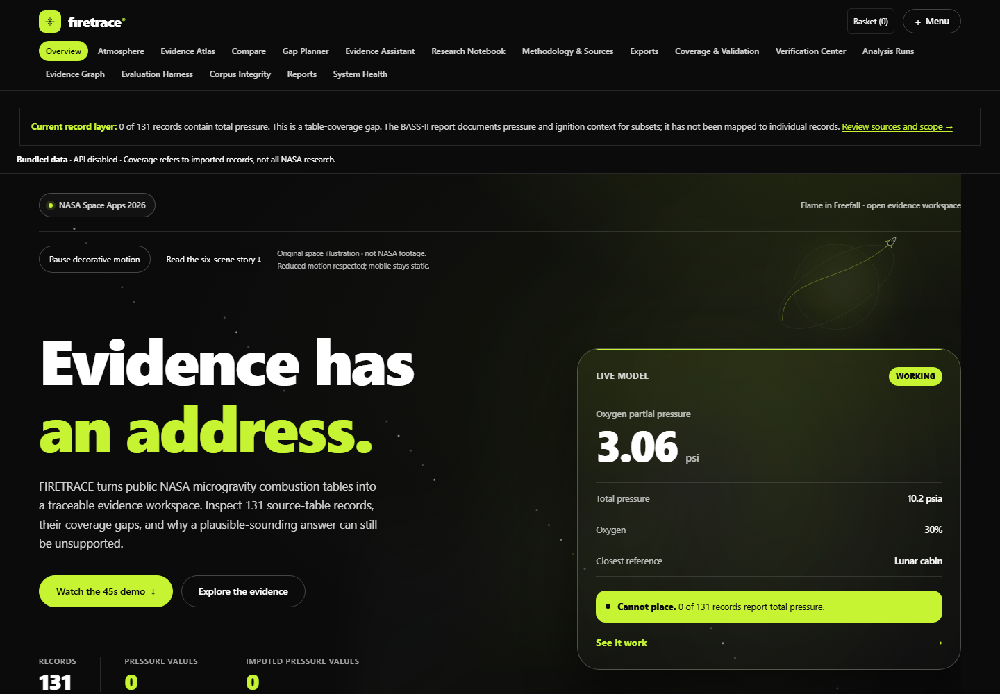

# FIRETRACE

**Know what the evidence says. See what it doesn't.**

A research dashboard by **The Code Blooded** for NASA Space Apps Challenge 2026:
[Flame in Freefall: SI-Powered Fire Safety Insights from Microgravity Combustion Data](https://www.spaceappschallenge.org/2026/challenges/flame-in-freefall/).

FIRETRACE turns NASA combustion tables and reports into a workspace for finding experiments,
checking their conditions, comparing evidence and identifying gaps relevant to spaceflight fire
research. Every displayed measurement retains its source and qualification. Unsupported questions
receive an explicit abstention. This is independent research support, without NASA endorsement,
material certification or fire-risk predictions.



[Submission text](docs/submission/project-page.md) · [Judge's walkthrough](docs/submission/judge-guide.md) ·
[Submission checklist](docs/submission/checklist.md) · [AI disclosure](AI_DISCLOSURE.md) ·
[Sources and credits](THIRD_PARTY_NOTICES.md)

## What you can do

| Research task | Working features |
|---|---|
| Find and inspect | Search/filter 131 experiment records; source rows, units, measurement ledger, raw values and quality flags; separate Research Library with report-page citations |
| Compare and plan | Side-by-side condition audit; atmosphere calculator; scenario evidence ranking with disclosed heuristic points and missingness; downloadable gap plan |
| Ask and verify | Deterministic cited answers and abstention; optional backend AI interpretation; claim verification; evidence graph; 36-case evaluation harness |
| Organize and export | Persistent evidence basket, Research Notebook, saved Atlas views, analysis runs, briefs and reports; CSV, JSON, Markdown, printable HTML and hashed ZIP exports |
| Audit | Methodology, source manifest, coverage, corpus integrity and real capability/status checks |

All 17 main pages have direct navigation tabs. Wider screens wrap tabs; narrow screens scroll
the tab strip. The Overview's six-scene story has pause and reduced-motion support. Its internal
45-second explainer is caption-only; **it is not the event's required <=30-second submission demo**.

## Actual NASA evidence

| Evidence layer | Included | Original source |
|---|---|---|
| Solid-fuel experiment records | 129 BASS-II table records | [PSI-25](https://psi.nasa.gov/physci/repo/data/investigations/PSI-25), DOI [10.60555/4qc4-de67](https://doi.org/10.60555/4qc4-de67) |
| Solid-fuel experiment records | 2 Saffire-I instrumented sample records | [PSI-98](https://psi.nasa.gov/physci/repo/data/investigations/PSI-98), DOI [10.60555/0t15-1z43](https://doi.org/10.60555/0t15-1z43) |
| Report findings | 8 BASS-II findings, with page locators | [NASA/TM-20210011385](https://ntrs.nasa.gov/citations/20210011385) |
| Report findings | 8 FLEX liquid-droplet findings, with page locators | [NASA/TP-2015-216046](https://ntrs.nasa.gov/citations/20150023456); [PSI-69](https://psi.nasa.gov/physci/repo/data/investigations/PSI-69) |
| Context only | LUCI partial-gravity research; not normalized test records | [NTRS 20250010653](https://ntrs.nasa.gov/citations/20250010653) |

**131 structured records + 16 separately curated report findings.** No normalized FLEX records;
no independent-burn count inferred from table rows. Report findings are excluded from numeric
experiment comparison and scenario ranking. Solid fuels and liquid droplets remain distinct.

The imported records contain no total pressure, measured per-test gravity, ignition method or
standardized outcome. Those fields remain null. This is a record-layer coverage gap: NASA reports
contain additional pressure/ignition context for subsets, which is not automatically assigned to
every row. Comparability depends on fuel, material, geometry, thickness, atmosphere, airflow,
scale and method. Scenario points express retrieval relevance, never a safety probability.

Original artifacts, hashes, units, versions and transformations are preserved in the
[source manifest](src/data/source_manifest.json), [data sources](docs/data_sources.md),
[data dictionary](docs/data-dictionary.md) and [research expansion](docs/research-expansion.md).

## Run locally

Requirements: Node.js 22.12+ or 24 LTS; Python 3.10+ for the optional API and data tools.
Commands below start from the repository root. On Windows PowerShell use `npm.cmd` if script
execution policy blocks `npm`; no system policy change is needed.

```bash
git clone https://github.com/MohammedAnasuddinZaid/NASA-hackathon.git
cd NASA-hackathon
npm ci
npm run dev
```

Open the URL Vite prints (normally http://localhost:5173). The frontend can browse bundled evidence
without a backend. The Evidence Assistant defaults to deterministic retrieval and can fall back
to the bundle when the API is unavailable.

To add the local evidence API, open a second terminal at the repository root:

```bash
python -m venv backend/.venv
# Windows:
backend/.venv/Scripts/python.exe -m pip install -r backend/requirements.txt
backend/.venv/Scripts/python.exe -m uvicorn api:app --app-dir backend --host 127.0.0.1 --port 8000
# macOS/Linux: replace backend/.venv/Scripts/python.exe with backend/.venv/bin/python
```

API documentation: http://127.0.0.1:8000/api/docs. Restart the frontend if its API target changes.
After the environment is installed, `npm run dev:full` starts both services on 5173/8000;
keep those ports free. See [startup and configuration](docs/deployment.md).

```bash
npm run build       # TypeScript check and static production output in dist/
npm run preview     # HTTP preview on http://localhost:4173
```

No deployment or public application URL is claimed. This public repository is the final-project
source link. A future hosted frontend does not deploy the backend automatically.

## Architecture and AI behavior

React 19 + TypeScript + Vite 7, custom CSS/SVG, Python FastAPI/Pydantic and a local SQLite/FTS
index. Data ingestion and validation run in Python. The implementation uses the existing
workspace stack; it does not require Next.js, Tailwind, Recharts, embeddings or a GPU.

The core assistant retrieves and explains evidence deterministically. Optional TRACE interpretation
uses one OpenAI API behind the backend only when explicitly enabled. It validates evidence IDs
and falls back when unavailable. No live provider response or speech quality was verified in the
release checks; model/API mocks establish contracts rather than live AI performance. Keys stay
server-side in ignored environment files. See [TRACE setup](docs/trace-assistant.md).

The optional legacy voice stack is separate from the evidence API; models are not shipped.
The five pre-existing narration clips have unverified authorship/rights and are excluded from
this submission release. Captions, playback controls and all evidence features remain available.

A service worker caches the app shell and loaded assets in production. Already-loaded/cached core
workflows can work offline. Lazy research files, original NASA PDFs and a cold cache can require
network access. Network font failure falls back to system fonts. This is no universal offline guarantee.

## Validation

The merged runtime baseline passed **316 frontend tests, 211 backend tests, 19 pipeline tests,
24 byte-identical scientific artifact checks and 36/36 benchmark cases**. Local browser suites:
88 default + 6 actual-API (including optional Swagger capture) + 2 TRACE + 5 integration + 33
expanded QA = 134 executions, including repeat coverage across routes and features.
Chromium, Firefox and WebKit navbar checks passed seven viewport widths (320-1920px).

[Hosted baseline checks](https://github.com/MohammedAnasuddinZaid/NASA-hackathon/actions/runs/43721404103),
[final navbar QA](docs/navbar-final-qa.md), [release review](docs/pr9-review.md),
and [submission preparation checks](docs/submission/verification.md) distinguish historical and latest runs.
The 30-question evaluation has zero grounding-integrity problems; retrieval hit@5 and abstention
accuracy are null because that question set lacks gold labels.

```bash
npm test
npm run build
npm run benchmark
python -m unittest discover -s pipeline -p 'test_*.py' -v
python scripts/verify-release-data.py
# With backend/.venv active and requirements-ai.txt installed:
python -m pytest backend/tests -q
python eval/run_eval.py
# Browser tools:
npx playwright install chromium
npm run e2e
npm run e2e:evidence
npm run e2e:trace
npm run e2e:integration
npm run e2e:qa
```

## Team and attribution

**The Code Blooded**

| Member | Space Apps username | Role confirmed by team |
|---|---|---|
| Abhishek Kumar Gupta | @abhi298 | Team Owner |
| Shiv Narain | @shivnarain99 | Team member |
| Mohammed Anasuddin Zaid | @mohd_anas176 | Team member |
| Ansh Devkate | @insanhii | Team member |
| Om Rupesh Kodilkar | @xomyux | Team member |

Member names/usernames come from the team owner's supplied roster. Specific development roles
are not invented. The team reports using ChatGPT, Codex, Claude Code, OpenCode, Cursor and
DeepSeek; known assistant contributions and the limits of tool attribution are documented in
[AI_DISCLOSURE.md](AI_DISCLOSURE.md) and [machine-readable metadata](public/ai-disclosure.json).
NASA measurements are original-source data, not AI-generated measurements.

PSI artifacts retain their CC0 designation; report rights are source-specific. Fonts and software
retain upstream licenses. See [third-party notices](THIRD_PARTY_NOTICES.md). No repository-wide
code license has been selected by the owners; public source access is not a blanket license for
third-party assets. Screenshots are real browser captures; code-based SVG illustrations are
conceptual, not NASA hardware or observed trajectories.

## Further documentation

[Judge's walkthrough](docs/submission/judge-guide.md) · [Methodology](docs/methodology.md) ·
[Scientific audit](docs/scientific-audit.md) · [Scenario policy](docs/scenario-planner.md) ·
[Basket and briefs](docs/research-exports.md) · [Known limitations](docs/limitations.md) ·
[Full integration history](docs/final-integration-review.md)

Historical PR reports preserve the state they reviewed. Current submission status is maintained
in [the submission checklist](docs/submission/checklist.md); it does not claim the event form has
been submitted, a demo uploaded or participant eligibility certified.
